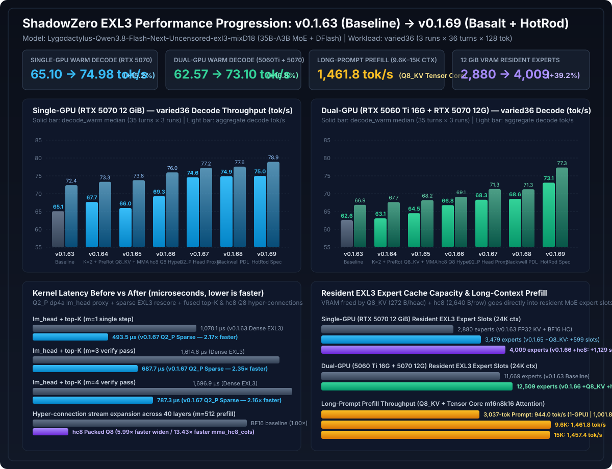
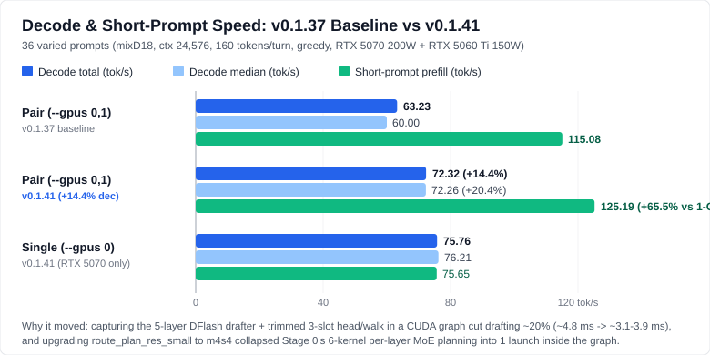
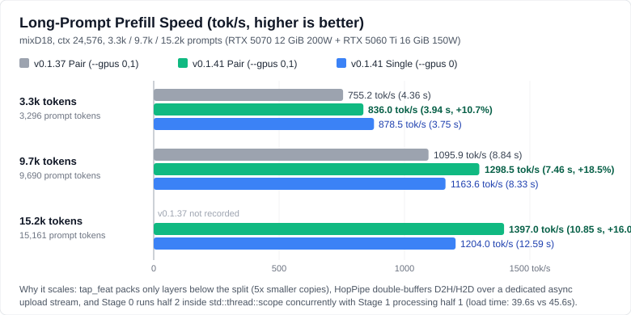
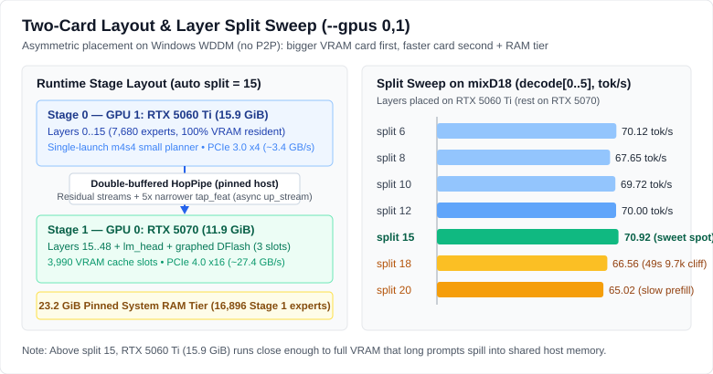

# ShadowZero

An engine for running Qwen3.8-Flash-Next mixture-of-experts models, built mainly in Rust.

**Based on [Strata](https://github.com/Niko1221/strata)** by Niko1221 and the Strata contributors, MIT licensed —
see [LICENSE](LICENSE) and [NOTICE](NOTICE). ShadowZero keeps that license and the upstream notice. It is not a copy
of Strata: its engine is its own. It does borrow parts, from Strata and from other projects, where they make ShadowZero
better, faster or more efficient, and [NOTICE](NOTICE) lists each one and where it came from.

## What it is

The plan is in [docs/SHADOW_PLAN.md](docs/SHADOW_PLAN.md), rewritten 2026-10-26. The short version:

- **ShadowZero is its own engine, start to finish.** A Rust host and CUDA kernels we write ourselves; the engine is not
  Strata's. Borrowed parts are welcome when they earn their place (the optional MTP draft head is one), and each is
  credited in NOTICE. The only required input is the GGUF.
- **The kernels are CUDA C++ source in this repo, compiled at run time by NVRTC** for whatever GPU is present, cached
  as CUBIN, and launched through the CUDA driver API (`nvcuda.dll`), hand-bound with no bindgen and no bindings
  crate. `cargo build` is the whole build: no nvcc, no CMake, no CUDA toolkit needed to compile ShadowZero.
- **The drive is the bound, not the language.** One process, 4 threads, queue depth 256: ~155k reads/s, and more
  threads or processes never add up to more. ShadowZero's ceiling on this PC is the same as any engine's. What it buys
  is an engine we own, safe by construction where Rust can make it so, with scheduling we can change.
- **Correctness before speed.** The stages each end in tokens: a scalar CPU reference first, the GPU dense path
  checked against it, then the memory tiers, the server, and only then speed, one lever at a time.

## Speed

Measured on the project test box (RTX 5070 12 GiB @ 200W + RTX 5060 Ti 16 GiB @ 150W, i7-11700K, 64 GB RAM, NVMe, Windows 11, `--ctx 24576`) running mixed EXL3 Qwen3.8-Flash-Next (`mixD18`), greedy decoding, with DFlash 2 speculation (`--spec 3`):

| setup | varied36 decode (warm median / aggregate) | short prompts | 3.0k prompt | 9.6k prompt | 15.0k prompt | resident EXL3 experts |
|---|---|---|---|---|---|---|
| Pair (`--gpus 0,1`, v0.1.63 baseline) | 62.57 / 66.88 tok/s | 124.9 tok/s | 978.5 tok/s | 1429.0 tok/s | 1424.6 tok/s | 11,669 slots |
| **Pair (`--gpus 0,1`, v0.1.69)** | **73.10 / 77.34 tok/s** | **134.5 tok/s** | **1001.8 tok/s** | **1461.8 tok/s** | **1457.4 tok/s** | **12,509 slots (+840)** |
| Single (`--gpus 0`, v0.1.63 baseline) | 65.10 / 72.41 tok/s | 88.2 tok/s | 927.4 tok/s | 1266.0 tok/s | 1312.5 tok/s | 2,880 slots |
| **Single (`--gpus 0`, v0.1.69)** | **74.98 / 78.94 tok/s** | **124.7 tok/s** | **944.0 tok/s** | **1289.7 tok/s** | **1337.1 tok/s** | **4,009 slots (+39.2%)** |

- **One GPU vs. two GPUs on this board:** Because the second PCIe slot on this motherboard is chipset-wired PCIe 3.0 x4 (`~3.4 GB/s` vs `27.4 GB/s` on the main slot) and WDDM disables P2P, single-card RTX 5070 keeps a ~2–3% decode edge while **two cards load faster (`39.6s` vs `45.6s`) and pull well ahead on prompts** (+14.0% at 15.0k, +13.3% at 9.6k) because layers `0..15` stay 100% resident on the 5060 Ti. In `v0.1.53`, async PLE prompt prefetch, `m4s4` EXL3 / `O(1)` bitmask routing, `<=4`-chunk single-pass handoff, and zero-alloc MoE planning improved dual-GPU `mixD18` prompt ingestion by **+2.6% to +6.5%** across `2.1k..15k` tokens ([docs/STATUS.md](docs/STATUS.md) 170–173). In `v0.1.64–v0.1.69`, EXL3 `K=2` coalescing / `sk4_m4` / pre-rotated `lm_head`, packed per-32 **`Q8_KV` cache** (`SHADOWZERO_KV_Q8=0` off), packed per-32 **`Q8` hyper-connections (`hc8`, `SHADOWZERO_HC_Q8=0` off)**, the 2-bit **`Q2_P` `lm_head` proxy + sparse EXL3 rescore** (`SHADOWZERO_HEAD_PROXY=0` off, `2.16x–2.35x` `lm_head + top-K` speedup), **Blackwell Programmatic Dependent Launch (`PDL`, `SHADOWZERO_PDL=0` off)**, and the 4-way trigram **`SuffixDrafter` + `propose_after` lookup chaining + cost-per-ms `DraftPolicy`** (`SHADOWZERO_SUFFIX_DRAFT=0` / `SHADOWZERO_DRAFT_POLICY=0` off) lifted single-GPU `varied36` warm median decode from **65.10 to 74.98 tok/s (`+15.2%`, `78.94 tok/s` aggregate)**, dual-GPU `varied36` warm median decode from **62.57 to 73.10 tok/s (`+16.8%`, `77.34 tok/s` aggregate)**, and single-GPU resident EXL3 expert cache capacity from **2,880 to 4,009 slots (`+39.2%`)** (`--exact` stays `kv: f32, hc: bf16, head: exl3`; [docs/STATUS.md](docs/STATUS.md) 174–179).
- **Earlier IQ3_S GGUF baseline vs. Strata:** On single-card IQ3_S (`v0.1.35–v0.1.36`), ShadowZero hit **55.7 tok/s** decode against Strata's **49.5 tok/s** (`+12.5%`, [docs/COMPARISON_STRATA_2026-11-11.md](docs/COMPARISON_STRATA_2026-11-11.md)) and up to **1,764 tok/s** on 15k prompts (`+16%`). Exact mode (`--exact`) turns off speculation and fast approximations (~20 tok/s on IQ3_S) to match the scalar reference bit for bit.









## Quick start

```bash
cargo build --release
shadowzero gpus                                # list cards and measure host <-> GPU / hop bandwidth
shadowzero serve path/to/model --gpus 0        # single GPU, fastest defaults (add --exact for bit-exact)
shadowzero serve path/to/model --gpus 0,1      # dual GPU, auto-splits layers across both cards
```

That opens the web chat UI at `http://127.0.0.1:8081/` (with a live multi-GPU Dashboard at `/#dash`) and an OpenAI-compatible API at `/v1/chat/completions`.

What every flag and environment switch does is in [docs/USAGE.md](docs/USAGE.md). ShadowZero keeps at least 4 GiB of system RAM free when sizing the pinned host expert tier, so on smaller machines pass `--ram-tier-gib` explicitly.

## Examples

Standalone, zero-dependency examples live in [`examples/`](examples/README.md):

- [`examples/quickstart_single_and_dual_gpu.ps1`](examples/quickstart_single_and_dual_gpu.ps1) — GPU/bandwidth probe and ready-to-run single-card, dual-card, and `--exact` launch commands
- [`examples/chat_and_streaming.py`](examples/chat_and_streaming.py) — non-streaming and SSE streaming `/v1/chat/completions` calls (including `reasoning_content` and `timings`)
- [`examples/agent_tool_loop.py`](examples/agent_tool_loop.py) — minimal local tool-calling agent loop using `/v1/tools`, `/v1/tools/execute`, and `finish`
- [`examples/watch_telemetry.py`](examples/watch_telemetry.py) — live terminal monitor for per-GPU utilization/VRAM, expert cache hit rate, RAM tier activity, and DFlash acceptance

## Documentation

| | |
|---|---|
| [docs/USAGE.md](docs/USAGE.md) | requirements, build, run, flags, environment variables, the API |
| [docs/SPECULATION.md](docs/SPECULATION.md) | the verify pass, the drafters (prompt lookup, MTP, DFlash 2), AcceptMoE, what did not work |
| [docs/BENCHMARKING.md](docs/BENCHMARKING.md) | the protocol, total-throughput scoring, resource charts, comparing with another engine, autotune, pitfalls |
| [docs/TOOLS.md](docs/TOOLS.md) | every tool and binary |
| [docs/STATUS.md](docs/STATUS.md) | what is measured, in order, including the wrong turns |
| [docs/ARCH.md](docs/ARCH.md) | the model as math, from the file and the reference |
| [docs/SHADOW_PLAN.md](docs/SHADOW_PLAN.md), [docs/HANDOFF.md](docs/HANDOFF.md) | the plan and the state handed over |
| [CHANGELOG.md](CHANGELOG.md) | release notes |

ShadowZero runs one model family: Qwen3.8-Flash-Next (everything above). Flint (`RecursiveSI/flint`, NVFP4) was removed from this
build on 2026-11-07 (it stays in git history, tag `pre-flint-removal`; it will be tested on tandem.cpp later), and a Flint file
is refused with a clear message. It is not a general LLM runner: a dense Llama or Qwen3 GGUF has no forward pass here.

## Server & Web UI

* **Desktop app (`shadowzero-ui.exe`)**: Windows launcher built with Tauri 2 (and headless server-only tray mode via `shadowzero-ui.exe --headless`), pointing at `http://127.0.0.1:8081`.
* **Chat UI & Dashboard**: Borderless timeline chat with a **Chats | Projects** sidebar (create jobs/projects, keep conversations ordered newest to oldest, assign chats across projects, and archive/restore older conversations), inline collapsible thinking traces, visible mid-task narration and uncollapsed tool steps (with an optional auto-collapse toggle in **Settings > Display**), reasoning-effort control, command palette (`Ctrl+Shift+P`), chat/project search (`Ctrl+K`), live context-window usage indicator, cancellable mid-reply message steering, inline generated photo (``) and playable video (`<video controls>`) cards, and local file/command/MCP tools. Rolling context compaction and optional auto-rollover (carrying pinned `Notes`) keep long agent sessions inside your VRAM budget, while the Dashboard (`/monitor` or `#dash`) tracks CPU, per-GPU load/VRAM/temps across both cards, expert-cache hit rates, and RAM/disk tier activity.
* **Local Media MCP (`media` in `mcp.json`)**: Optional isolated Python stdio MCP server (`tools/media_mcp.py`, setup via `F:\ShadowMedia\venv` and `I:\ShadowMediaModels`) exposing `generate_photo` (HD `Z-Image-Turbo`), `generate_video` (HD `Wan2.2-TI2V-5B` T2V/I2V), and `upscale_media` (4K `3840x2160` `Real-ESRGAN` + NVENC/x264) by temporarily parking dual-GPU LLM VRAM (`POST /v1/engine/park`), running on the highest-VRAM GPU in a clean child worker, saving outputs under `outputs/`, and reloading the engine (`POST /v1/engine/resume`).
* **API**: `POST /v1/chat/completions` (streaming or non-streaming), `GET /v1/models`, `/health`, `/metrics` (Prometheus), `/v1/status`, `/v1/telemetry`, `/v1/tools`, `/v1/tools/execute`, `GET`/`POST /v1/pc-control` (loopback-only opt-in Windows PC Control with always-on-top takeover banner, glowing screen border, and `Ctrl+Alt+Esc` emergency kill-switch), `GET`/`HEAD /v1/media/<file>` (with `Range` byte requests for video), and loopback-only `POST /v1/engine/park` & `POST /v1/engine/resume`.

## Layout

    crates/          the engine (shadowzero-model, shadowzero-cuda, shadowzero-serve, shadow), shadowzero-bench, shadowzero-eval
    kernels/         the CUDA C++ compiled at run time with NVRTC
    examples/        quick PowerShell & Python examples (chat, streaming, tools, live GPU telemetry)
    docs/            USAGE, SPECULATION, BENCHMARKING, TOOLS, STATUS, plans, and docs/charts/ SVGs
    bench/           shadowzero-bench runs, one directory per comparison
    profiles/        routing profiles for the RAM tier's placement
    tools/           the harness and shadowzero_memory.py
    bin/ models/     the embedder the memory tool drives
    memory/          the store — committed, so it travels with the repo
    eval/            the frozen yardstick: cases.jsonl, baseline.jsonl, prompts/, answers/

`tools/shadowzero_memory.py` is stdlib-only: `add`, `index`, `search`, `stats`. Embedding is not done in Python —
the tool shells out to `bin/llama-embedding.exe` with `models/bge-small-en-v1.5-q8_0.gguf` (384 dims). Search
is cosine over the whole store, no ANN, since the store is a few thousand records at most.

## The yardstick

`eval/cases.jsonl` is 14 questions this project actually asked, each with the record that should answer it. It is
**frozen**: a self-improvement loop may edit its skills, its prompts and its index parameters, but not this file —
a ruler the measured thing is allowed to move stops being a ruler. Grading is substring matching, not an LLM
judge, because a judge inside the loop is slow and gets gameable the moment the loop learns what it likes.

The tool is `crates/shadowzero-eval` — Rust, because the project is Rust. Two arms, split on purpose:

- **`cargo run -p shadowzero-eval -- rank`** — retrieval only. It touches no model, so it is deterministic and it can be
  run from inside the session being improved. Baseline 2026-10-26, 16 records: **12/14 top-1, MRR 0.911**, recorded
  in `eval/baseline.jsonl`; `verify` re-ranks and fails loudly if it has moved.
- **`cargo run -p shadowzero-eval -- run`** — the answer arm. It needs a live model, and it spawns a **fresh** harness
  session per case (one call, no tools, no skills) so the answer comes from the retrieved notes alone. Baseline, same
  day: **14/14**, graded with `answers`. Two of the fourteen are answered correctly *despite* the retriever ranking
  them 2nd and 4th — the answer arm passes where the rank arm does not, which is the honest reason to keep both arms
  and not just the convenient one.

The rank arm reproduces exactly; the answer arm does not, because it is a live model — re-running it reproduces the
verdict, not the wording. That is the whole reason the deterministic arm is the one with a recorded baseline.

The loop this enables is one edit at a time — a skill file, a prompt, an index parameter — re-scored, kept only if
it beats baseline by more than the noise floor in [BENCH_NOISE.md](docs/BENCH_NOISE.md), and reverted otherwise.
The model's weights are frozen, so every gain has to land as an artifact: a skill, a record, a tool. That is
accumulation with a keep/revert gate, and it compounds; it is not the weights getting smarter, and it is not
recursive past the point where the evaluator is fixed.

## License

MIT, with both copyright holders. [NOTICE](NOTICE) says which parts came from where.
