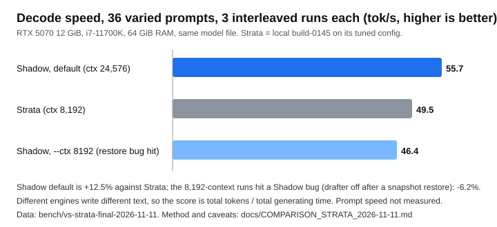

# Shadow against Strata, measured 2026-11-11

One machine, one model, one bench, three interleaved runs of each engine, every figure from a fresh server. The raw data
is in [`bench/vs-strata-final-2026-11-11`](../bench/vs-strata-final-2026-11-11) (per-turn timings, server logs, GPU / PCIe /
RAM samples once a second); the method is [BENCHMARKING.md](BENCHMARKING.md).



## Result (decode, 36 different prompts, 96 tokens a turn)

| engine and setting | decode tok/s (3 runs) | against Strata |
|---|---|---|
| **Shadow 0.1.36, default** (`shadow serve MODEL`, context 24,576; no conversation restore happened) | **55.72** (55.6, 55.7, 55.9) | **+12.5%** |
| Strata (local build, context 8,192, its tuned config) | 49.52 (50.0, 49.1, 49.6) | |
| Shadow 0.1.36, `--ctx 8192` (**a snapshot restore at turn 20 switched Shadow's drafter off for the rest of the run: a bug, below**) | 46.43 (46.3, 46.4, 46.6) | **-6.2%** |
| *the same `--ctx 8192` run after the fix (STATUS 99; 0.1.36 plus the fix, 2 runs, measured separately from the three rows above)* | *55.66 (55.6, 55.7)* | *+12.4%* |

Read it as: **when nothing goes wrong Shadow decodes 12.5% faster than Strata; in this bench the `--ctx 8192` runs hit a
Shadow bug and fell to 6% behind.** The bug (found while checking this comparison, STATUS 98): when a chat turn makes the
server restore an earlier conversation snapshot, it marks the DFlash drafter as broken and never turns it back on, so the
rest of the session decodes without it (speculation falls back to prompt lookup and plain one-token steps). In this bench
the restore happened at turn 20 (and again at turn 34) in both `--ctx 8192` and `--ctx 10240` runs, whose replies are the
same text, and in one of two `--ctx 12288` runs (at turn 10); no run without a restore was slow, and every run with one
was (20 of 20 runs). **It is the restore, not the context length**: the 8,192 setting only decided which replies came
out. A real chat that goes back to an older turn can hit it at any context. **Fixed the same day (STATUS 99, off switch
`SHADOW_DF_KEEP=0`)**: the drafter keeps the K/V it still has after a restore. The same `--ctx 8192` bench, two interleaved
runs against the unfixed build: 46.6 before, **55.7 after** (the replies and the drafting statistics are identical up to the
restore at turn 20; after it, 35.4 against 56.5 tok/s). The fixed row is not from the same session as the Strata runs
(Strata was not re-run), so the +12.4% beside it compares two sessions of the same machine; the first three rows are the
interleaved comparison, kept as measured.

Per turn (warm turns, all three runs):

| | Shadow default | Shadow `--ctx 8192` | Strata |
|---|---|---|---|
| wall clock a turn | 1.57 s | 1.87 s | 2.03 s |
| prompt time a turn (mean / median) | 658 / 618 ms | 648 / 588 ms | 702 / **411** ms |
| tokens generated a turn | 49.9 | 56.0 | 42.0 |
| server ready after launch | 38 s | 38 s | 33 s |
| lowest free RAM during the run | 5.8 GiB | 5.2 GiB | 9.6 GiB |
| peak VRAM | 11.3 GiB | 11.3 GiB | 11.2 GiB |
| run-to-run floor (median) | 0.4% | 0.4% | 5.3% |

The wall-clock row is not like for like: the engines write different amounts of text per turn (49.9 against 42.0 tokens
for Shadow default and Strata), so a turn is not the same work. **Strata answers the short prompts of this bench sooner at
the median (411 ms against 618 ms)**; Shadow's mean is lower only because Strata has some slow turns. Shadow also uses more
of the PC's RAM (it pins about 39-41 GiB for its expert tier; Strata's budget here is 36 GiB).

## What was run

* **Machine:** RTX 5070 (12 GiB, driver 621.01), Core i7-11700K, 64 GiB RAM at 2,933 MT/s, Windows 11, nothing else on the GPU. Shadow and Strata
  alternate, a fresh server per run, the run order rotated.
* **Model:** the same file for both, Swift Qwen3.8-Flash-Next IQ3_S (2 shards).
* **Prompts:** `bench/dfdata/varied36.json`, 36 unrelated user prompts (alpaca and code-alpaca style) sent as one
  conversation, 96 new tokens each, greedy, thinking off. Turn 0 is dropped.
* **Score:** total throughput = tokens generated / time spent generating them, over the warm turns
  (`tools/bench_total.py`). The medians are not used: the engines produce different text, so turn *t* is not the same
  work (BENCHMARKING.md, "Score by total throughput").
* **Shadow:** `target/release/shadow.exe`, built from this repository at the commit that carries this file, default flags
  (the default fast mode: fused int8 expert kernels, DFlash 2 drafter, tail skip 3, RAM tier sized from free memory,
  39-41 GiB here, floor 3.5 GiB) with `--ctx 24576` stated out loud for the first row, and `--ctx 8192` for the third.
* **Strata:** the engine build already on this PC (`build-0145/strata.exe`, built 2026-10-17) launched by Strata's own
  Python server with the user's tuned configuration (36 GiB resident budget, its expert profile, the MTP drafter, `--spec 4`,
  int8 KV), changed only by `tools/strata_bench_cfg.py` to switch off everything outward-facing and set the context to
  8,192 and greedy sampling.

## What this does not show (read before quoting it)

* **Strata is not the newest release.** Strata 0.2.11 (engine 0.1.57) was out when this was run; we measured the older
  local build because that is what the earlier benches used. It may be faster. A fresh run against the current release
  is the fair next step.
* **The engines generate different text.** Both are in fast, inexact modes (Shadow skips low-weight experts and
  speculates; Strata speculates with an MTP drafter), so the same prompt gives different replies and a different amount
  of text (Shadow 1,746 tokens a run, Strata 1,469 at default). Decode speed depends on the text. The runs agree within
  0.5% for Shadow and 2% for Strata, but that is the same text each time, not the same text across the engines.
* **One machine, one model, one prompt set, one context length.** Nothing here says how either engine behaves on other
  hardware, other models or long prompts.
* **Prompt (prefill) speed was not measured in this run.** Earlier notes in STATUS.md claim Shadow is ahead at 15k-token
  prompts and level at 9.6k; those figures are older than this build and are not repeated here.
* **Each engine got its own best setup, and neither was tuned on these prompts.** Shadow's expert placement was recorded
  from 300 other prompts; Strata's profile is its usual mixed one.
* **The speed Shadow shows depends on the restore bug above, found by accident** (a quoting slip in a side experiment ran
  the default context and decoded 20% faster than the standard bench's `--ctx 8192`; chasing that led to the restore).
  The earlier published "52.1 against 47.7 tok/s" (2026-10-31) is **superseded**: it was Shadow at `--ctx 8192` on an older
  build, before this was measured against the restore; on today's build that setting reads 46.4 (restore at turn 20) and
  Strata 49.5, and the default 55.7.

## Reproduce

```bash
cargo build --release -p shadow -p shadow-bench
python tools/strata_bench_cfg.py SCRATCH_DIR            # writes SCRATCH_DIR/strata-bench.json from your Strata config
target/release/shadow-bench run --model MODEL.gguf --out bench/NAME --runs 3 --turns 36 \
    --prompts-file bench/dfdata/varied36.json \
    --arm "shadow=--ctx 24576" --arm-exe "shadow=target/release/shadow.exe" \
    --arm "strata=-" --arm-launch "strata=& 'tools/run_strata.ps1' -Port {port} -Out '{log}' -Config 'SCRATCH_DIR/strata-bench.json'"
python tools/bench_total.py bench/NAME
```

The exact command and every launch line are in `bench/vs-strata-final-2026-11-11/plan.json` and `results.jsonl`. The
other runs of the day are kept beside it: `bench/vs-strata-2026-11-11-attempt1-strata-failed` (Strata would not start:
its Python `regex` package had been emptied), `bench/vs-strata-2026-11-11` (the first complete run, Shadow `--ctx 8192` against Strata: 45.6 against
49.1) and `bench/shadow-regress-2026-11-11` (today's build against the 2026-11-10 and 2026-11-08 builds at the default
context: 55.5, 55.7 and 52.4 tok/s, so no regression between them).
